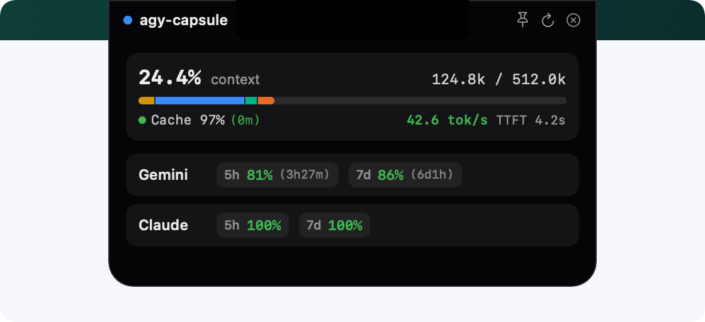

# AgyIsland

A lightweight, native macOS Dynamic Island (`NSPanel` + SwiftUI) for Antigravity's [`agy-capsule`](https://github.com/Lumidarin/agy-capsule) plugin — **zero CDP / `--remote-debugging-port` required**.

> 专为 Antigravity `agy-capsule` 打造的原生 macOS 刘海灵动岛悬浮窗，**无需开启 CDP 调试端口**即可在屏幕顶部实时查看上下文占用、缓存命中率、生成速度与模型配额。

## Screenshots

### Compact (Notch Ears)


### Expanded (Hover / Pinned)


## Features

- **Notch-Native & Non-Activating**: Automatically detects MacBook Pro notch geometry (`NSScreen.safeAreaInsets` & `auxiliaryTopLeftArea` / `auxiliaryTopRightArea`) and docks around the physical notch without stealing keyboard focus (`NSPanel` `.nonactivatingPanel`). Falls back to a centered top pill on non-notch displays.
- **Zero-CDP Telemetry**: Automatically discovers the running `agy-capsule` sidecar port from `~/.gemini/antigravity/sidecar_data/agy-capsule/agy_capsule/logs/sidecar.log` and polls `http://127.0.0.1:<port>/api/context` every `1.5s`.
- **Compact Mode**:
  - **Left Ear**: Status dot + context usage percentage (amber `>=75%`, red `>=90%`).
  - **Right Ear**: Latest generation speed (`tok/s`) + Gemini `5h` remaining quota.
- **Expanded Card** (hover to expand, click pin to lock):
  - Multi-segment context bar (`Turn0` / `Read` / `Thinking` / `Output`) and token counts.
  - Prompt cache hit rate (`cachedIn / (cachedIn + uncachedIn)`) + idle timer alert (amber at 3m, red at 4m).
  - Generation speed (`tok/s`) & `TTFT`.
  - Model quota pools (`Gemini`, `Claude / GPT`) with `5h` & `7d` remaining percentages and reset countdowns.
  - Menu bar status item for quick show/hide, pin, refresh, and quit.

## Requirements

- macOS 14.0+ (Apple Silicon / Intel)
- Xcode Command Line Tools (`swiftc`)
- [Antigravity](https://antigravity.google) with the [`agy-capsule`](https://github.com/Lumidarin/agy-capsule) plugin enabled

## Build & Run

```bash
git clone https://github.com/xxxxzb/agy-island.git
cd agy-island
chmod +x build.sh
./build.sh
open ./build/AgyIsland.app
```

Optionally copy `./build/AgyIsland.app` to `/Applications/`.

## License

[MIT](./LICENSE)
